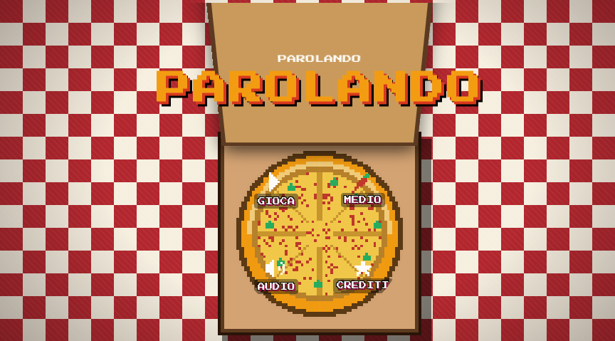

  <!-- BANNER INIZIALE (CONTIENE GIÀ IL TITOLO GRAFICO) -->
  

    

  

    
    
    
    
  

 

  <h2 style="color: #f39c12; text-transform: uppercase; margin-top: 0;">🌐 ABOUT THIS GAME / INFORMAZIONI SUL GIOCO</h2>
  
<b>[EN]:</b> Parolando is an 8-bit retro arcade word game set in Italy. Challenge smart difficulty-based bots (Tourists, Locals, and Grannies), type words under time pressure, enjoy procedural pixel art graphics, and listen to an immersive built-in Web Audio API digital tarantella synthesizer.

  
<b>[IT]:</b> Parolando è un gioco di parole in stile arcade retro 8-bit ambientato in Italia. Sida bot intelligenti basati su diverse difficoltà (Turisti, Locali e Nonne), componi parole sotto pressione temporale, goditi la grafica pixel art procedurale e ascoltati la colonna sonora digitale generata nativamente con la Web Audio API.

 

  <h3 style="text-transform: uppercase; margin-top: 0; color: #f39c12;">⚡ CORE HIGHLIGHTS / CARATTERISTICHE PRINCIPALI</h3>
  <ul>
    <li><b>Author / Autore:</b> Giuseppe Caldarola (<i>Seneoo</i>).</li>
    <li><b>Retro Aesthetics:</b> Custom pixel-art canvas elements, pizza box opening animations, and authentic 8-bit styling.</li>
    <li><b>Audio Engine:</b> Native Web Audio API synthesizer creating procedural chiptune music and sound effects without external audio files.</li>
    <li><b>Interactive Gameplay:</b> QWERTY touch-optimized mobile keyboard, dynamic bot personalities, and multiple difficulty tiers.</li>
    <li><b>Bilingual Support:</b> Full support for both Italian and English languages with instant localization switching.</li>
  </ul>

 

  <h3 style="text-transform: uppercase; margin-top: 0; color: #c0392b;">🔒 LICENSE / LICENZA</h3>
  
<b>[EN]:</b> © Giuseppe Caldarola (Seneoo). All rights reserved. This is a proprietary project. Copying, modifying, distributing, or using this code and its assets in any way, shape, or form is strictly prohibited without explicit written permission.

  
<b>[IT]:</b> © Giuseppe Caldarola (Seneoo). Tutti i diritti riservati. Questo è un progetto proprietario. È severamente vietato copiare, modificare, distribuire o utilizzare questo codice e le relative risorse in qualsiasi modo o forma senza previa autorizzazione scritta.

 

  
<b>🔗 LINKS & CONTACTS</b>

  
  
  

 
